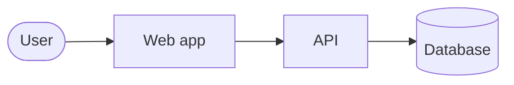

# {Kind}: {subject}

{One line: what this diagram shows and at which level of abstraction.}

Last checked against the system: YYYY-MM-DD. Explained in: [overview](../overview.md#3-building-blocks).

